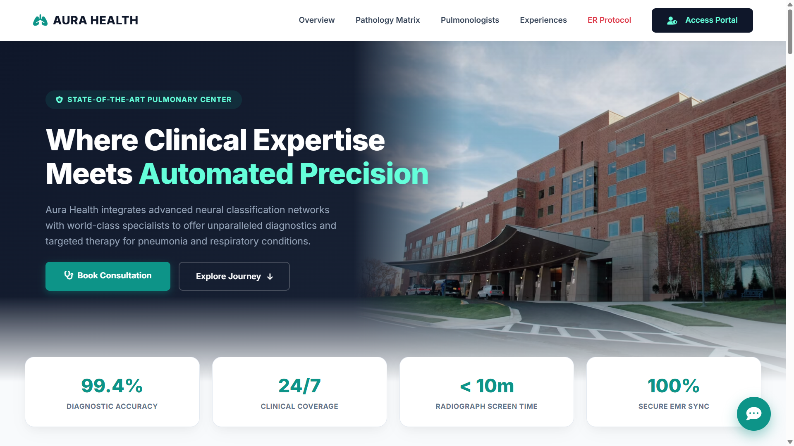
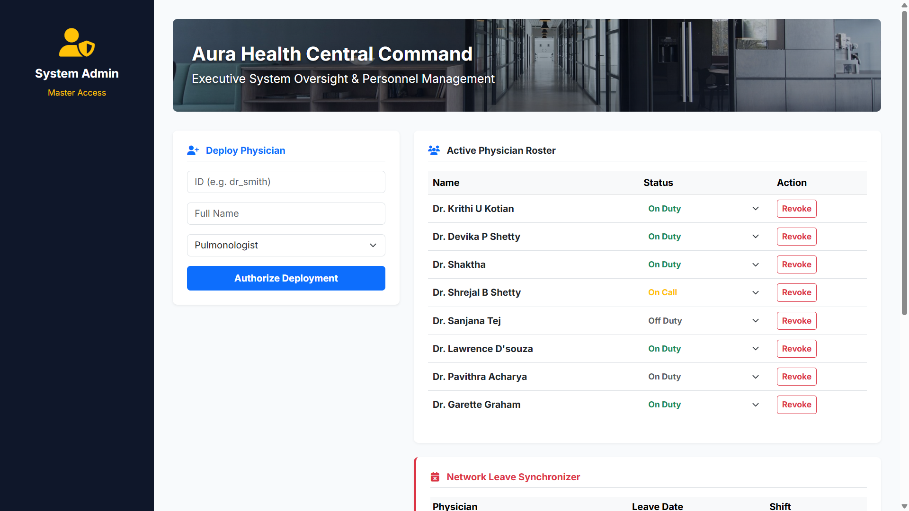
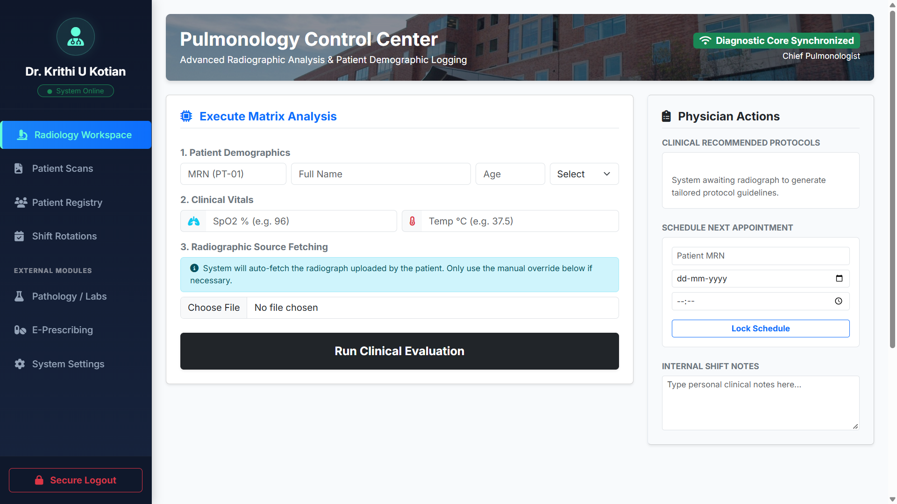
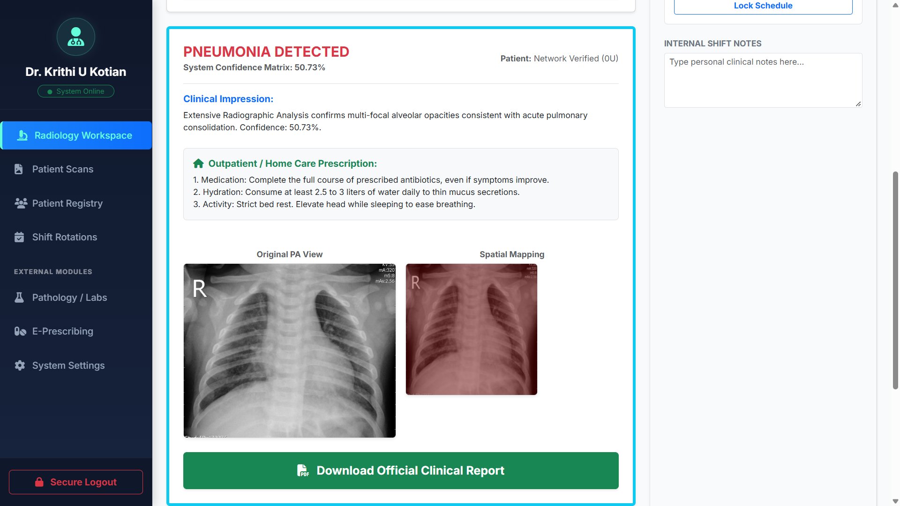
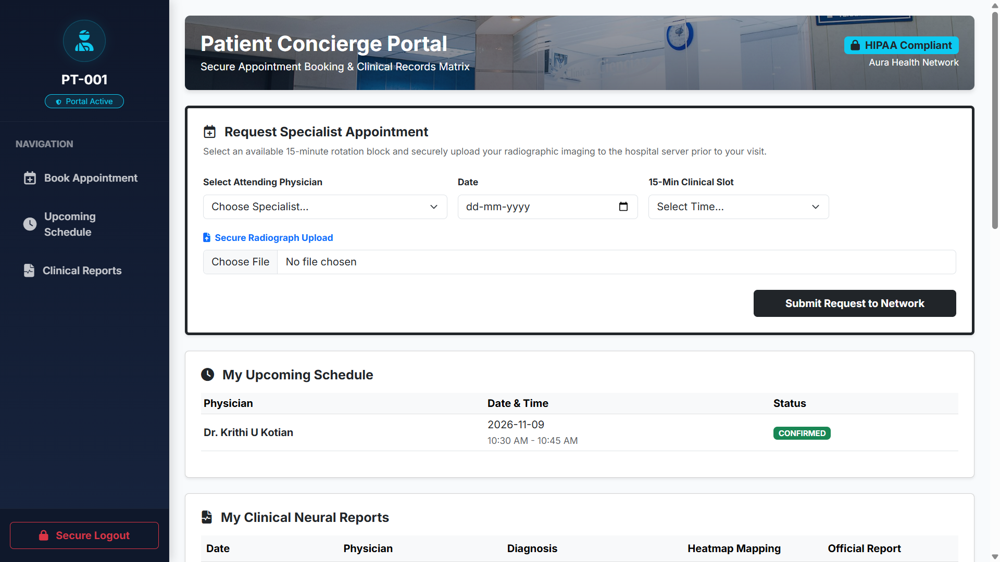

# Aura Health - Automated Pulmonary Diagnostic Network

  
  
  
  
  
  

Aura Health is a full-stack, AI-integrated healthcare web platform designed to automate pulmonary diagnostics, manage patient electronic medical records (EMR), and streamline clinical workflows. 

This enterprise-grade system bridges the gap between machine learning and daily hospital operations, providing real-time pneumonia detection via neural networks alongside robust administrative tools for physicians.

## 🖥️ Platform Interface

| System Landing Page | System Administrator Panel |
| :---: | :---: |
|  |  |
| **Aura Health Portal** | **Enterprise Management & RBAC** |

| Pulmonology Control Center | AI Diagnostic Output |
| :---: | :---: |
|  |  |
| **Physician Roster & Records** | **Grad-CAM Thermal Opacity Map** |

| Patient Portal | Automated Reports |
| :---: | :---: |
|  | *(Upload a screenshot of your PDF invoice or report here, name it report.png, and it will appear automatically)* |
| **Patient EMR Access** | **Dynamic EMR & Billing Generation** |

## 🚀 Core Features
* **AI Diagnostic Matrix:** Utilizes a DenseNet121 neural network to analyze patient X-rays, outputting diagnostic confidence and generating spatial Grad-CAM heatmaps to visualize pulmonary opacities.
* **Role-Based Access Control:** Distinct, secure routing for Patients, Physicians, and System Administrators.
* **Automated EMR Generation:** Dynamically generates downloadable PDF clinical reports integrating patient vitals, AI findings, and superimposed thermal maps.
* **Enterprise Billing System:** Instantly generates professional, formatted PDF invoices for hospital services.
* **Electronic Pharmacy Routing (eRx):** DEA-formatted electronic prescription generator for outpatient care.

## ⚙️ System Architecture
The application handles multi-stage image preprocessing (grayscale normalization, array scaling) before feeding data into the neural engine. The classification threshold is highly tuned to `0.35` to prevent model collapse in clinical settings, ensuring high sensitivity to multi-focal alveolar opacities.

*(Note: Due to GitHub file size limits, the trained DenseNet121 `.keras` model file and the local SQLite test database are excluded from this repository to protect data integrity.)*

## 💻 Local Installation & Execution
1. Clone the repository: `git clone https://github.com/yourusername/AuraHealth.git`
2. Install dependencies: `pip install -r requirements.txt`
3. Initialize the database: `python setup_db.py`
4. Boot the server: `python app.py`
5. Access the platform at `http://localhost:5000`